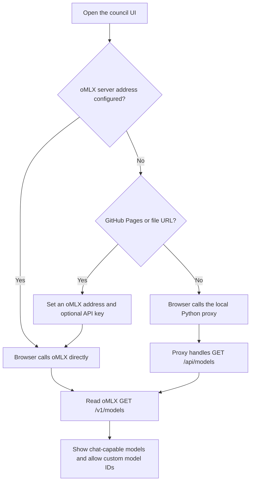
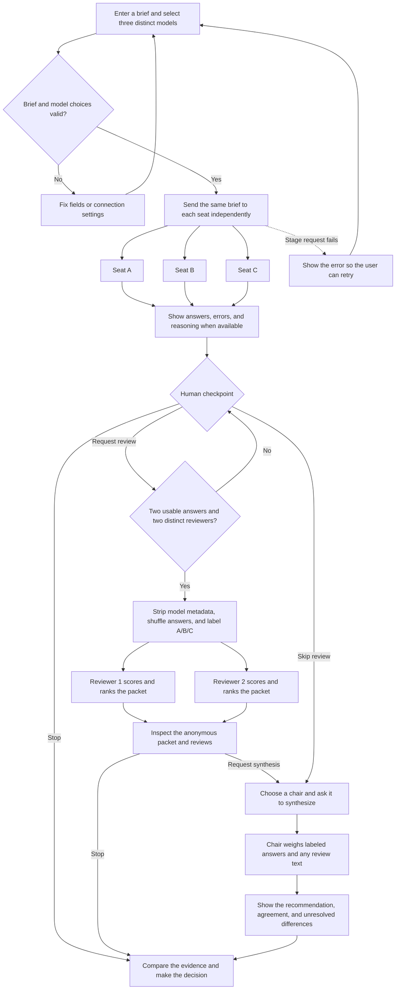
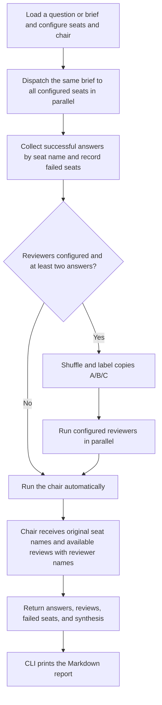
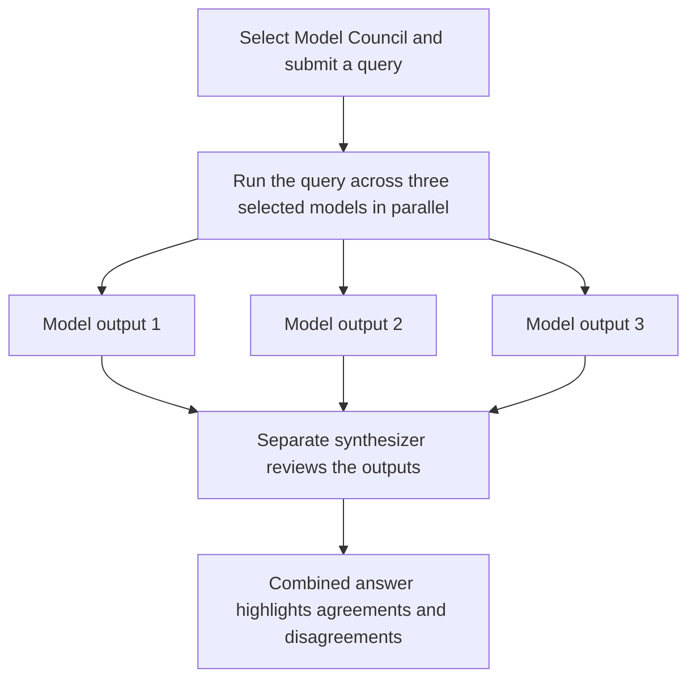
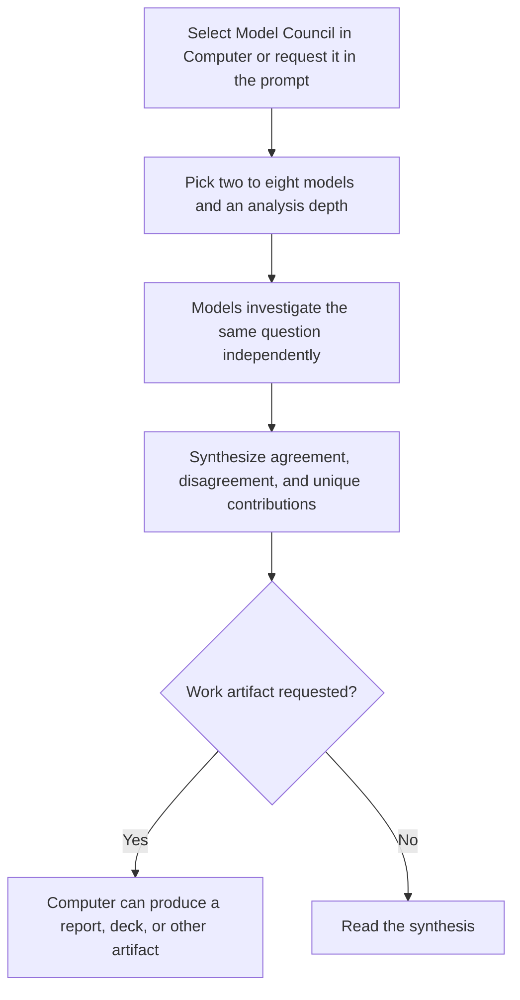

# Running a council, step by step

[香港廣東話](workflow_zhHK.md)

This guide documents the browser-based oMLX workflow, the original Python reference, and Perplexity's published Model Council flows. The [operator checklist](#operator-checklist) applies when you plan, review, or record a real decision.

## Current workflow with oMLX

### Connect and discover models

The browser uses one transport for discovery and all three council stages. The same frontend works when served by the Python proxy and when deployed as static files.

In proxy mode, the Python server holds the optional oMLX API key, and the browser shows a waiting state until a stage returns. In direct mode, the browser can show per-call completion counts and uses the optional key entered in its settings. A static HTTPS page needs a reachable HTTPS endpoint and a CORS policy that permits the page's origin. [Setup and privacy](omlx-local-council.md).

For inference, the browser sends one request per stage to the proxy (`/api/council`, `/api/council/review`, or `/api/council/synthesize`), or sends each model request directly to oMLX at `POST /v1/chat/completions`.

### Run the three stages

1. **Dispatch.** The UI checks the brief, connection, and model IDs. An attached image must be at most 8 MB and the browser checks all three model IDs against its vision-model heuristic. The same brief and optional image go to three concurrent calls. Each seat can return its own answer or error. When present, explicit reasoning fields and inline `<think>` text are displayed separately.
2. **Human checkpoint and optional review.** The user can stop, ask for review, or go directly to synthesis. Review requires at least two usable answers and two distinct reviewer models. Both reviewers independently score the same shuffled packet and rank its answers. Labels hide model IDs supplied as metadata. Identity clues written into the answer text can still be visible.
3. **Manual synthesis.** The user chooses one chair and explicitly starts synthesis. The chair receives the question, labeled answers, and any available review text, with reviewer labels numbered. When the user skips review, labels follow the successful dispatch order. The Python synthesis endpoint requires two answer packets. The browser's direct path can attempt synthesis with fewer, so check the evidence available before relying on the result.
4. **Afterward.** The user makes the final decision. Drafts, choices, settings, and up to eight recent briefs are saved in the browser. Answers, reasoning, images, and review packets stay in the current run. The browser times out discovery after 15 seconds and stage or completion requests after 180 seconds. These limits describe how long the browser waits.

Implementation: [browser orchestration](../web/app.js) · [Python proxy and stages](../council/omlx_server.py).

## Original workflow with the Python CLI

The upstream reference wraps AWS Bedrock models in Python callables. Library users can also pass compatible callables. The orchestration runs through to the chair within one invocation. [Original implementation at `d5f9327`](https://github.com/kfc283-sudo/model-council/blob/d5f9327/council/run_council.py).

The CLI defaults to two Bedrock seats and uses the first as chair unless configured. It reports failed seats and skips review when fewer than two answers succeed. Its review prompt hides answer authors, but its synthesis prompt uses the original seat names and names any reviewers whose reviews it includes. The upstream [workflow guide](https://github.com/kfc283-sudo/model-council/blob/d5f9327/docs/workflow.md) recommends a retry and an anonymized chair packet as operating practice. The reference orchestrator itself does not implement either behavior.

## Progress in the oMLX fork

| Area | Original CLI | Current oMLX browser workflow |
|---|---|---|
| Runtime | Bedrock in the supplied CLI, with generic callables for library use | Installed oMLX models, using either the Python proxy or direct browser transport |
| Control | Decide on review before starting; the chair runs automatically | Inspect independent answers before choosing review, synthesis, or a stopping point |
| Anonymity | Shuffle answer copies for reviewers; the chair gets named inputs | Reviewers receive shuffled labels and the chair receives labeled answers and numbered reviews |
| Inputs and results | Text brief and a Markdown report | Optional image input, separate reasoning and run details, and progress and errors in the UI |
| Deployment and preferences | Python CLI or library | Local browser UI or static GitHub Pages, with English/Hong Kong Cantonese and System/Light/Dark appearance |

The fork adds local oMLX execution and a browser workspace, discovers models dynamically, supports images and separate reasoning, and adds per-stage controls. GitHub Pages extends access to a browser on another machine. Language and appearance preferences shipped in [PR #1](https://github.com/dtywong/model-council-omlx-preview/pull/1).

### Further work

- Align proxy and direct synthesis when seats fail, including how both paths handle too few usable answers.
- Make the default **Answer max** pass the browser's numeric validation. The current default of 2,500 conflicts with the field's 128-token increment. A value of 2,560 is valid.
- Add an opt-in run export that records timings, failures, and the final human decision for the [scorecard](scorecard_schema.md).
- Benchmark a strong single seat against dispatch plus synthesis and dispatch plus blind review. Compare answer quality, fault detection, and latency on the same briefs.

## Perplexity Model Council

These diagrams represent published product behavior. Perplexity's launch material describes a three-model Search flow. Its later Computer documentation describes a configurable council for the same question.

### Search at launch

The synthesizer compares the outputs, resolves conflicts where possible, and produces a combined answer. [Perplexity's launch announcement](https://www.perplexity.ai/en-GB/hub/blog/introducing-model-council).

### Computer

Computer adds configurable council size and analysis depth. Its tooling can turn the synthesis into an artifact. [Perplexity's Computer announcement](https://www.perplexity.ai/en-GB/hub/blog/model-council-comes-to-computer).

### How it compares with oMLX

| Dimension | Perplexity's documented flow | Current oMLX workflow |
|---|---|---|
| Models | Hosted models; three at Search launch and two to eight selectable in Computer | Three independent seats from a configured oMLX catalog |
| Timing and control | Perplexity runs the models and synthesizes as part of the request | The user reads the seat cards and manually chooses the next stage and chair |
| Review | A synthesis model compares outputs. The cited materials do not describe a separate blind scoring round or how model identities are handled internally. | An optional round asks two reviewers to independently score and rank a shuffled answer packet |
| Deliverable | Combined research answer; Computer can generate a report, deck, or other artifact | Individual answers and a user-triggered recommendation in the browser |
| Execution boundary | Perplexity-managed service | Inference runs on the configured oMLX host, which can be on the same machine or reached over the network |

## Operator checklist

Use these steps to plan and evaluate a council on a real question. They describe operating practice, including manual actions such as retrying a failed seat and logging a scorecard. See the [pattern](pattern.md) for when a council is worth running and the [member registry](member_registry.md) for how to choose seats.

### 0. Guardrails, checked before anything else

- **Decide a council is actually warranted** (see [`pattern.md`](pattern.md)'s "when it's worth
  it" section). If the answer is checkable, don't convene a council, verify directly instead.
- **Decide your sensitivity posture up front, once, and stick to it for the whole run.** If
  the question involves anything you would not want to leave your own control (confidential
  business information, personal data, anything under an NDA), restrict seats to providers
  you have an explicit trust/data-handling basis for, and never route that content through a
  provider you haven't cleared for it. Decide this before Stage 1, not mid-run.
- **Strip identifiers before anything goes to a third-party API**, even in the non-sensitive
  case: account numbers, personal names, internal paths, anything that would mean something
  to someone paying attention. This is a habit worth having regardless of stakes.
- **Give every seat an explicit isolation instruction**: work only from the brief provided,
  no tools, no file access, no exploring, unless the seat's actual job requires it. State
  this up front in every seat's prompt, don't assume it.

### 1. Convene — pick the configuration

Decide: how many seats, which models, 2-stage (answer → synthesize) or 3-stage (answer →
anonymized peer review → synthesize). Use [`member_registry.md`](member_registry.md)'s
starting-point table, then adjust against your own scorecard evidence as it accumulates.

Write one brief: the actual question, the motivation behind it, and what a good answer
looks like (acceptance criteria / report format). Every seat gets the identical brief. The
brief should not hint that other seats exist or what they might say.

### 2. Stage 1 — parallel answers

Dispatch the same brief to every seat at the same time, independently. Save every answer
verbatim, before anyone has seen anyone else's. If a seat fails (rate limit, timeout), retry
once after a short pause, then proceed without it and note the degradation rather than
silently continuing as if nothing happened.

### 3. Stage 2 — anonymized peer review (skip for 2-stage / routine councils)

1. Shuffle the answers and relabel them (Answer A, B, C…). Keep the mapping separate,
   never expose it to a reviewer.
2. Every reviewing seat sees the brief plus all anonymized answers, including its own, and
   returns: strengths, weaknesses/errors, a score, and a ranking. Every reviewer does this
   independently and in parallel.
3. Save each review.

### 4. Stage 3 — chairman synthesis

Someone (a strong model, or a human) sees the anonymized answers and, if this was a 3-stage
run, the reviews. They produce the final output by actively selecting and weighting, not by
blending everything into an average. For a genuinely contested question, they should also
produce a short account of where the seats agreed, where they split, and which way the
verdict went and why — that record is often as valuable as the final answer itself.

**One rule that matters more than it sounds like it should:** if every single reviewer
independently flags the same problem with the leading answer, that is not something to wave
through as "a known limitation." Something every seat agrees is a real issue, resolve it or
escalate it, don't just note it and move on.

### 5. Afterward

Log the run: which seats, what config, what the outcome was, and — once you know — whether
the humans accountable for the decision actually agreed with how it held up. This is what
turns "the council said so" into an improving, evidence-based practice instead of a ritual
you repeat on faith. See [`scorecard_schema.md`](scorecard_schema.md).
