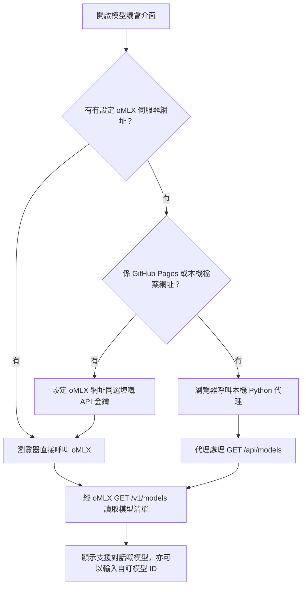
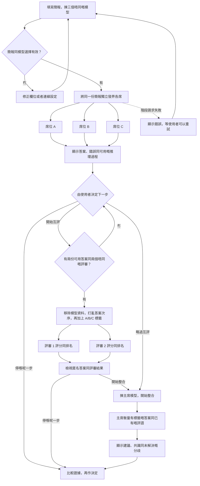
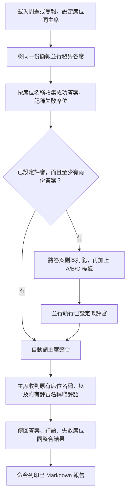
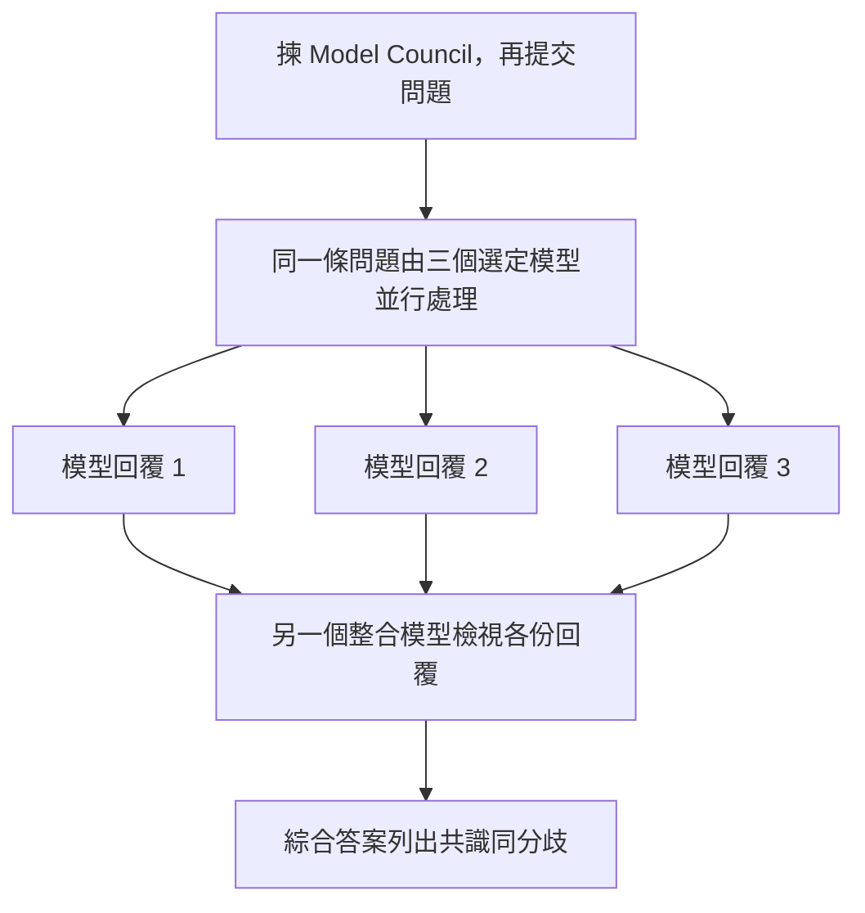
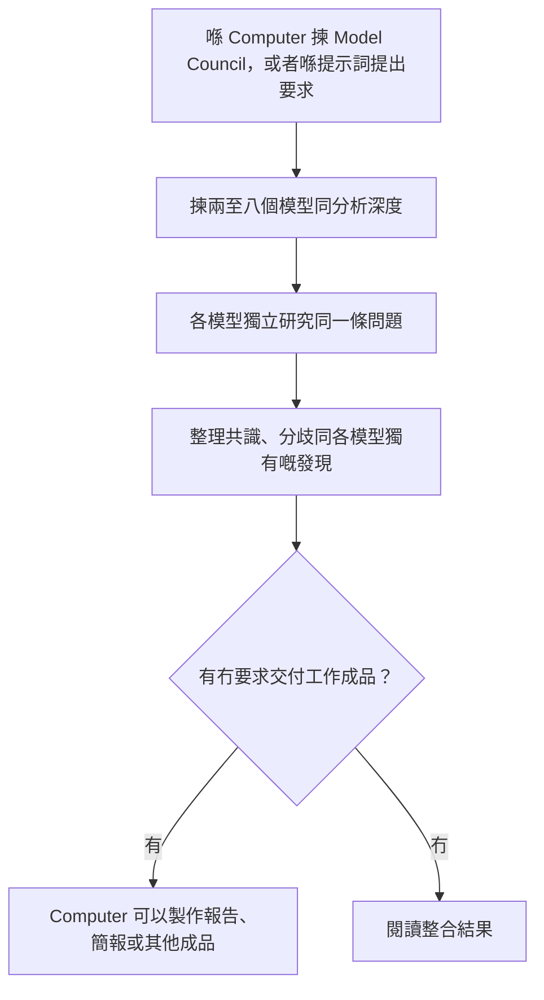

# 點樣召集模型議會

[English](workflow.md)

呢份指南講解本機 oMLX 網頁嘅現行流程、原版 Python 實作，同埋 Perplexity 公開嘅 Model Council 流程。要規劃、覆核或者記錄一次真實決策，可以參考[操作清單](#操作清單)。

## oMLX 現行流程

### 連線同搵模型

瀏覽器用同一種連線方式搵模型同執行三個議會階段。同一套前端可以由 Python 代理提供，亦可以部署成靜態網頁。

代理模式由 Python 伺服器保管選填嘅 oMLX API 金鑰。瀏覽器會等到整個階段傳回先有結果。直連模式可以顯示已完成嘅請求數。HTTPS 靜態網頁需要連得通嘅 HTTPS 端點，而 CORS 亦要准許網頁嘅來源。瀏覽器會用設定入面選填嘅金鑰。[設定同私隱](omlx-local-council_zhHK.md)。

進行推理時，瀏覽器可以每個階段向代理發一個請求（`/api/council`、`/api/council/review` 或 `/api/council/synthesize`），或者將每個模型請求直接發去 oMLX 嘅 `POST /v1/chat/completions`。

### 執行三個階段

1. **分派。** 介面會檢查簡報、連線同模型 ID。附圖上限係 8 MB，瀏覽器會根據模型 ID 估計三個模型係咪都支援視覺輸入。三個並行請求會收到同一份簡報同選填嘅圖片。每席可能傳回答案或者個別錯誤。有推理欄位或者內嵌 `<think>` 文字時，介面會分開顯示。
2. **由使用者決定下一步，互評屬選做。** 你可以停低、開始互評，或者直接請主席整合。互評至少需要兩份可用答案同兩個唔同嘅評審模型。兩個評審會各自為同一組已打亂次序嘅答案評分同排名。答案標籤會隱藏附帶嘅模型 ID。答案文字本身仍然可能透露身份。
3. **手動請主席整合。** 由使用者揀一個主席模型，再手動開始整合。主席會收到問題、有標籤嘅答案同現有嘅評語，評審以數字標示。略過互評時，標籤按成功回覆嘅分派次序排列。Python 整合端點要求至少兩份答案。瀏覽器直連可以用少過兩份答案嘗試整合，採用結果前要先確認證據夠唔夠。
4. **完成之後。** 最終決定由使用者作出。瀏覽器會儲存草稿、選項、設定同最多八份近期簡報。答案、推理、圖片同互評資料只留喺今次執行。瀏覽器等候模型清單最多 15 秒，等候各階段或者個別回覆最多 180 秒。

相關程式見[瀏覽器流程](../web/app.js)同[Python 代理及各階段](../council/omlx_server.py)。

## 原版 Python 命令列流程

上游參考實作用 Python 可呼叫函數封裝 AWS Bedrock 模型。當程式庫使用時，亦可以傳入兼容嘅函數。一次呼叫就會自動跑到主席整合。[原版實作 `d5f9327`](https://github.com/kfc283-sudo/model-council/blob/d5f9327/council/run_council.py)。

命令列預設用兩個 Bedrock 席位，除非另行設定，否則第一席會做主席。程式會報告失敗席位，成功答案少過兩份就略過互評。互評提示詞會隱藏答案作者，但整合提示詞會用原有席位名稱，亦會列出有提供評語嘅評審名稱。上游[流程指南](https://github.com/kfc283-sudo/model-council/blob/d5f9327/docs/workflow.md)建議操作者重試一次同將主席收到嘅答案匿名化。呢兩項係操作建議，原版協調程式並未實作。

## oMLX 分支做咗啲咩

| 範疇 | 原版命令列 | 目前 oMLX 瀏覽器流程 |
|---|---|---|
| 執行方式 | 隨附命令列用 Bedrock，程式庫支援通用可呼叫函數 | 用已安裝嘅 oMLX 模型，經 Python 代理或者由瀏覽器直連 |
| 控制權 | 開始之前決定做唔做互評，之後自動請主席整合 | 睇完各席答案，再決定互評、整合或者停低 |
| 匿名處理 | 將答案副本打亂畀評審，主席收到具名資料 | 評審收到打亂後嘅答案標籤，主席收到有標籤嘅答案同編號評語 |
| 輸入同結果 | 文字簡報同 Markdown 報告 | 選填圖片、分開顯示推理同運行詳情，介面亦會顯示進度同錯誤 |
| 部署同偏好 | Python 命令列或者程式庫 | 本機瀏覽器或者 GitHub Pages，支援英文、香港廣東話，同系統、淺色、深色外觀 |

呢個分支加入本機 oMLX 執行同瀏覽器工作區，支援動態搵模型、圖片、分開顯示嘅推理，以及逐階段控制。GitHub Pages 令其他機嘅瀏覽器都可以用。語言同外觀選項喺 [PR #1](https://github.com/dtywong/model-council-omlx-preview/pull/1) 加入。

### 後續工作

- 統一代理同直連喺席位失敗時嘅整合行為，特別係可用答案唔夠嘅情況。
- 令預設嘅**答案 token 上限**可以通過瀏覽器驗證。目前預設 2,500 同欄位每級 128 token 嘅規則唔相符。2,560 係有效數值。
- 加入可選嘅執行記錄匯出，將用時、失敗情況同最終人手決定記入[評分表](scorecard_schema_zhHK.md)。
- 用相同簡報比較單一強模型、分派加整合，同分派加匿名互評再整合，比較答案質素、搵到幾多錯誤同需時。

## Perplexity Model Council

以下圖表按 Perplexity 公開嘅產品資料繪製。推出時嘅 Search 用三個模型。之後 Computer 嘅文件描述咗同一條問題可以交畀自選模型組合處理。

### 推出時嘅 Search

整合模型會比較回覆，盡量解決衝突，再提供綜合答案。[Perplexity 推出公告](https://www.perplexity.ai/en-GB/hub/blog/introducing-model-council)。

### Computer

Computer 可以調整席位數量同分析深度，亦可以將整合結果製成工作成品。[Perplexity Computer 公告](https://www.perplexity.ai/en-GB/hub/blog/model-council-comes-to-computer)。

### 同 oMLX 比較

| 範疇 | Perplexity 公開嘅流程 | oMLX 現行流程 |
|---|---|---|
| 模型 | 託管模型。Search 推出時用三個，Computer 可以自選兩至八個 | 從已設定嘅 oMLX 模型清單揀三個獨立席位 |
| 時序同控制權 | Perplexity 喺同一個請求入面運行各模型再整合 | 使用者先睇各席回覆，再手動揀下一個階段同主席 |
| 評審 | 整合模型比較回覆。引用嘅資料冇交代有冇獨立匿名評分階段，亦冇交代內部點處理模型身份。 | 可以請兩個評審為已打亂次序嘅答案獨立評分同排名 |
| 交付結果 | 綜合研究答案。Computer 可以製作報告、簡報或其他成品 | 各席答案同由使用者觸發嘅整合建議喺瀏覽器顯示 |
| 執行位置 | Perplexity 管理嘅服務 | 喺已設定嘅 oMLX 主機推理，可以係本機或者經網絡連去嘅主機 |

## 操作清單

以下係用議會處理真實問題時嘅操作建議，包括人手重試失敗席位同記錄評分表。想知幾時值得召集議會，可以睇[議會模式](pattern_zhHK.md)。揀席位時可以參考[成員名冊](member_registry_zhHK.md)。

### 0. 開始前嘅原則

- 先諗清楚值唔值得召集議會。有客觀答案嘅問題可以直接核實。
- 一開始就定好資料敏感度同處理方式。如果涉及機密業務資料、個人資料或者保密協議內容，全程只用你已經核准、清楚佢點處理資料嘅服務商。
- 將資料送去第三方 API 之前，先移除帳戶號碼、人名、內部路徑等識別資料。一般問題都可以養成呢個習慣。
- 畀每一席清楚嘅隔離指示。除非任務本身有需要，否則只用簡報所提供嘅內容，唔好用工具、讀檔或者探索其他資料。

### 1. 設定議會

決定用幾多席、邊啲模型，同埋跑兩階段（作答 → 整合）定三階段（作答 → 匿名互評 → 整合）。可以由[成員名冊](member_registry_zhHK.md)入面嘅組合開始，之後按你記低嘅結果調整。

寫一份共同簡報，包含問題、點解要問，以及你點樣衡量好答案，例如接受準則或者報告格式。每一席收到同一份簡報。簡報避免暗示其他席位嘅存在或者佢哋可能答啲咩。

### 2. 第一階段：並行作答

將同一份簡報同時獨立發畀所有席位。各席未睇到其他答案之前，先原樣儲存各份答案。如果有席位遇到速率限制或逾時，稍等之後重試一次。如果仍然失敗，就記低缺咗邊份答案，再決定點樣繼續。

### 3. 第二階段：匿名互評

1. 打亂答案次序，再標示為答案 A、B、C 等。另存對照表，唔好畀評審睇到。
2. 每個評審睇同一份簡報同所有匿名答案，當中可以包括自己嘅答案。各評審獨立並行工作，交代每份答案嘅優點、弱點或者錯誤、分數同總排名。
3. 儲存每份評語。

兩階段流程或者例行問題可以略過呢一步。

### 4. 第三階段：主席整合

由一個強模型或者一位人類主席睇匿名答案。有做互評嘅話，主席亦會睇埋評語。主席要揀出證據同衡量分量，再提出結論。遇到真正有爭議嘅問題，簡單記低各席喺邊度有共識、邊度有分歧，同點解最後咁判斷。

如果所有評審獨立指出領先答案有同一個問題，就要解決或者交畀負責人跟進。單靠標註「已知限制」唔足以處理一致指出嘅問題。

### 5. 完成後記錄

記低席位、設定同結果。知道決定後續表現之後，再記低負責作決定嘅人點評價。累積例子後就有依據去改進議會組合同操作方法。見[評分表格式](scorecard_schema_zhHK.md)。
